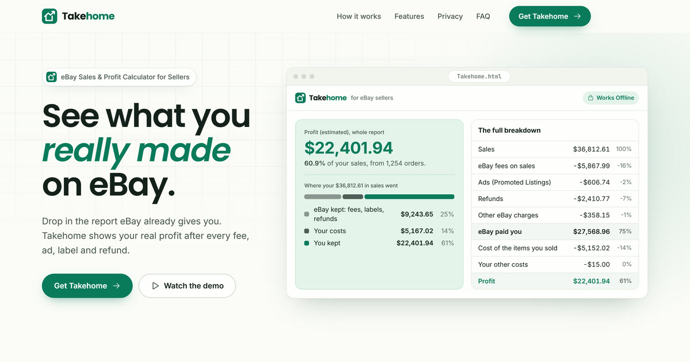
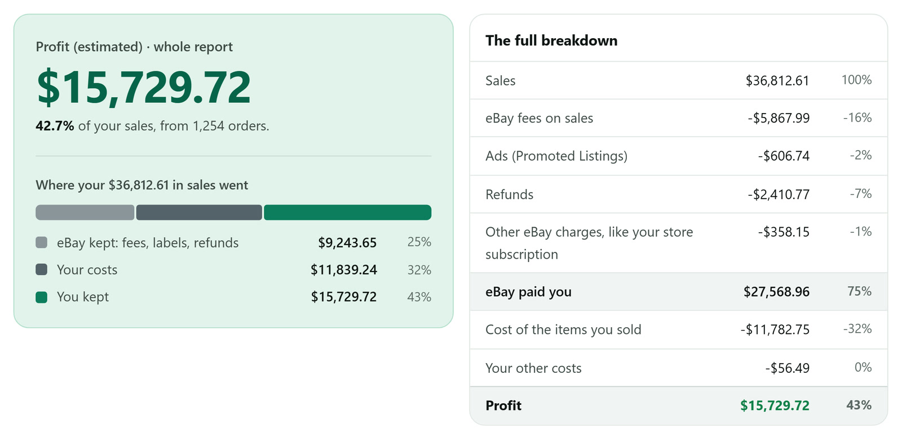
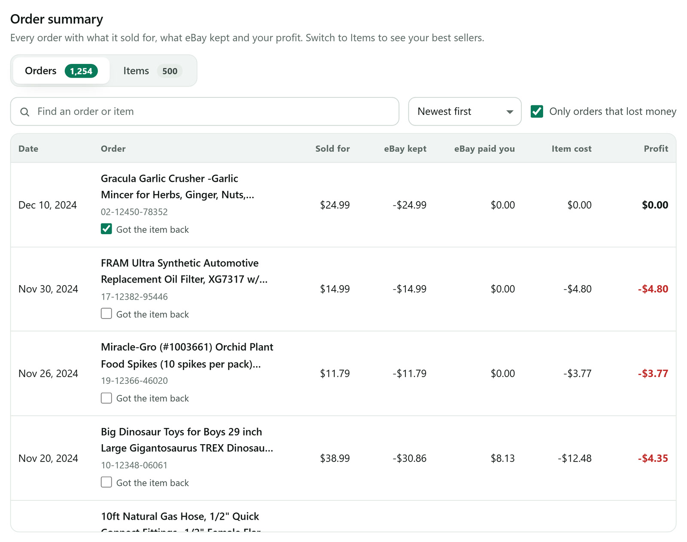
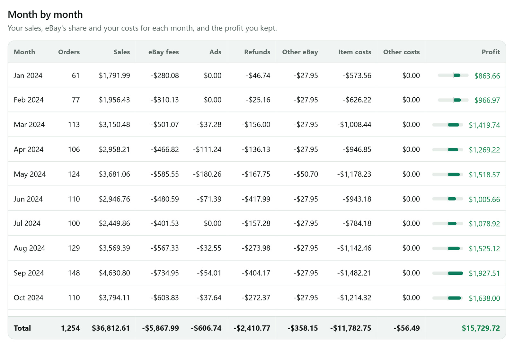
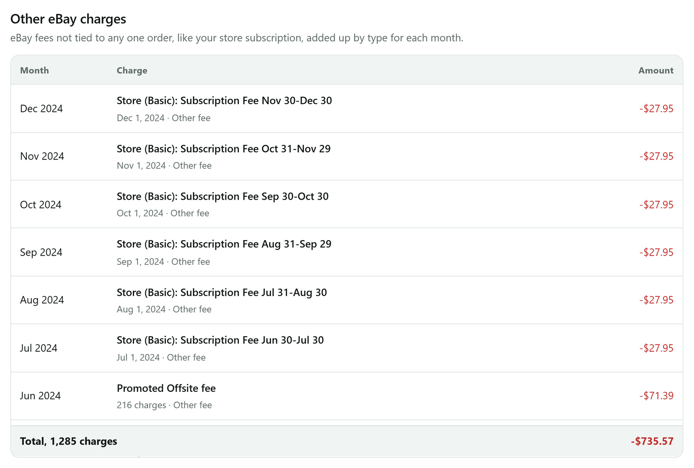
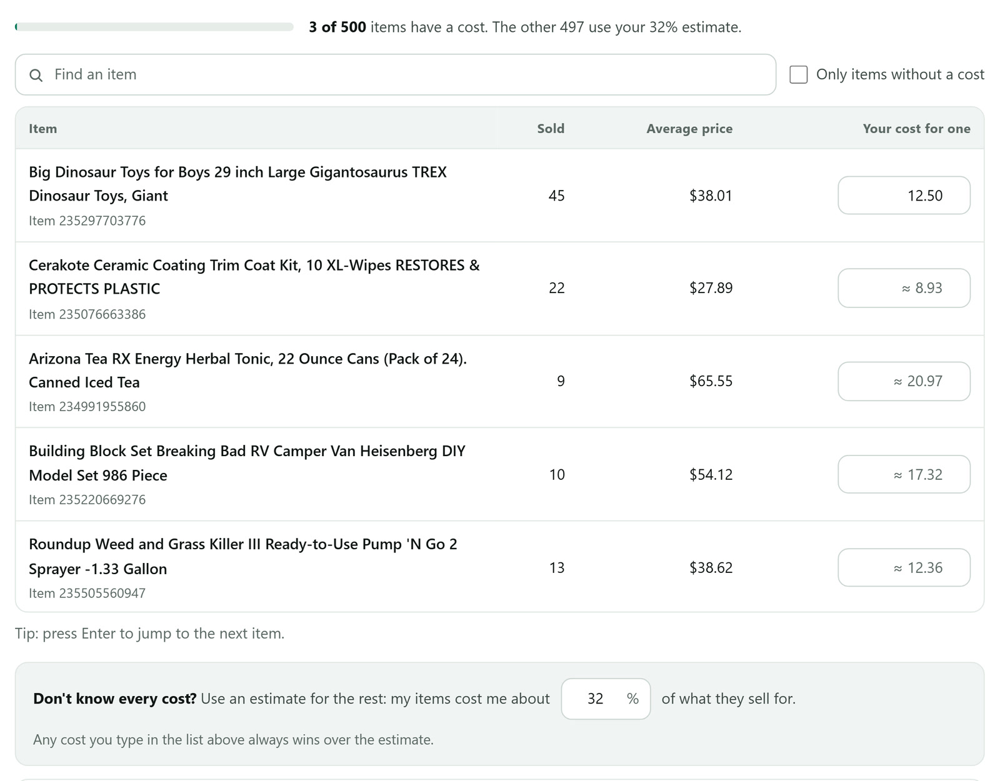
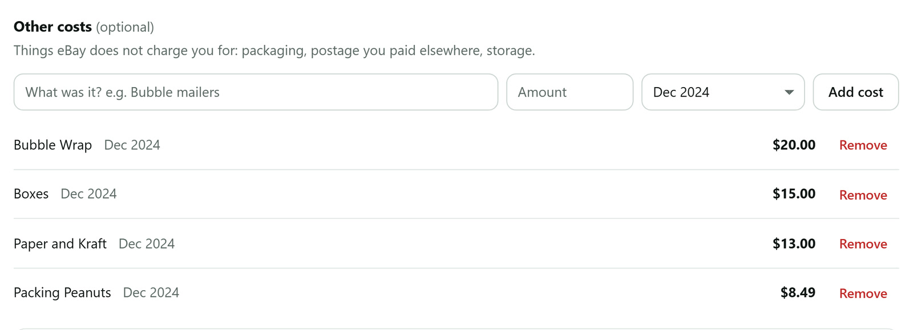

  

<h1 align="center">Takehome: eBay Sales &amp; Profit Calculator for Sellers</h1>

  <b>See what you really made on eBay, after every fee, ad, label and refund.</b> 
  Drop in the Transaction report eBay already gives you. No spreadsheets, no login, works offline.

  <a href="https://takehomesellers.com/"><b>Website</b></a> &nbsp;|&nbsp;
  <a href="https://www.etsy.com/listing/4588417596"><b>Get Takehome</b></a> &nbsp;|&nbsp;
  <a href="https://takehomesellers.com/ebay-fee-calculator"><b>Free eBay fee calculator</b></a> &nbsp;|&nbsp;
  <a href="docs/how-to-download-your-ebay-transaction-report.md"><b>Get your eBay report</b></a> &nbsp;|&nbsp;
  <a href="../../issues/new/choose"><b>Report a bug or ask for a feature</b></a>

---

## Your payout isn't your profit

eBay pays out what's left after its fees. What your stock, packaging and refunds cost you never shows up in that number. Takehome reads your eBay Transaction report and shows the real number, per order, per item and per month.

  

## What it shows you

| | |
|---|---|
| **Your real profit** after eBay fees, Promoted Listings, postage labels, refunds and your own costs |  |
| **Orders that lost money**, with one tick, including returns where you got the item back |  |
| **Every month at a glance**: sales, eBay's share, costs and profit |  |
| **Every eBay charge counted**, like your store subscription and fees not tied to one order |  |
| **Your costs, your way**: type a cost per item, or use one percentage estimate for the rest |  |
| **Packaging and supplies too**: bubble wrap, boxes, postage bought elsewhere |  |

## How it works

1. **Download your eBay report.** In Seller Hub, go to **Payments**, then **Reports**, and download the free Transaction report. [Step-by-step guide](docs/how-to-download-your-ebay-transaction-report.md)
2. **Drop it into Takehome.** It opens in your web browser and reads the file on your own computer.
3. **Add your costs and see your profit.** Per item, or one % estimate. Then print it, save a PDF or export your orders.

## Private by design

- **Nothing is uploaded.** Takehome is a single file that runs in your browser and is blocked from connecting to the internet.
- **No account and no eBay password.**
- **Pay once.** No subscription.

Works in Chrome, Edge, Firefox, Safari, Brave and DuckDuckGo on Windows and Mac.

## Free tools for eBay sellers

Want to check a single sale before you list it? These are free, with no sign-up:

- **[Free eBay fee calculator](https://takehomesellers.com/ebay-fee-calculator)**: every eBay fee for a sale, what eBay pays you, your profit and your break-even price, for every eBay.com (US) category and Store level. It runs in your browser and nothing you type is sent anywhere.
- **[Takehome connector for Claude](https://takehomesellers.com/claude)**: ask Claude what eBay will charge for a sale, what you will keep, what price gets you a target profit, or whether an eBay Store would save you money. Setup steps are on the page.

Takehome does the same maths for every order in your eBay report at once.

## Get Takehome

Takehome is a paid download (one-time payment, instant download).

**[Get it on Etsy](https://www.etsy.com/listing/4588417596)** &nbsp;or visit **[takehomesellers.com](https://takehomesellers.com/)**

## About this repository

This repository is the public home for Takehome's **feedback, roadmap and documentation**. The app itself is sold separately, so its code isn't included here.

- Found a bug? [Open a bug report](../../issues/new?template=bug_report.yml)
- Want a feature? [Request a feature](../../issues/new?template=feature_request.yml)
- What's new: [CHANGELOG](CHANGELOG.md)

Please never attach your real eBay report to an issue. It contains your sales and buyer details. A screenshot with personal details covered is enough.

## FAQ

**Which eBay report do I need?**
The Transaction report (CSV) from Seller Hub, Payments, Reports. The Orders report won't work because it has no fees in it.

**Do I need Excel or Google Sheets?**
No. Takehome is not a spreadsheet template. It opens in your browser and does the maths for you.

**Does it work outside the US?**
It's tested with English-language eBay.com (US) reports. Other eBay sites may work, but aren't guaranteed yet.

**Is there a free version?**
Takehome itself is a paid download. For one sale at a time, the [free eBay fee calculator](https://takehomesellers.com/ebay-fee-calculator) shows every fee and your profit.

**Is this accounting or tax advice?**
No. It's a profit report to help you understand your selling.

---

  Made by <a href="https://www.linkedin.com/in/mahmood-i-saeed">Mahmood Saeed</a>

Not affiliated with, endorsed by or sponsored by eBay Inc. "eBay" is a trademark of eBay Inc.

